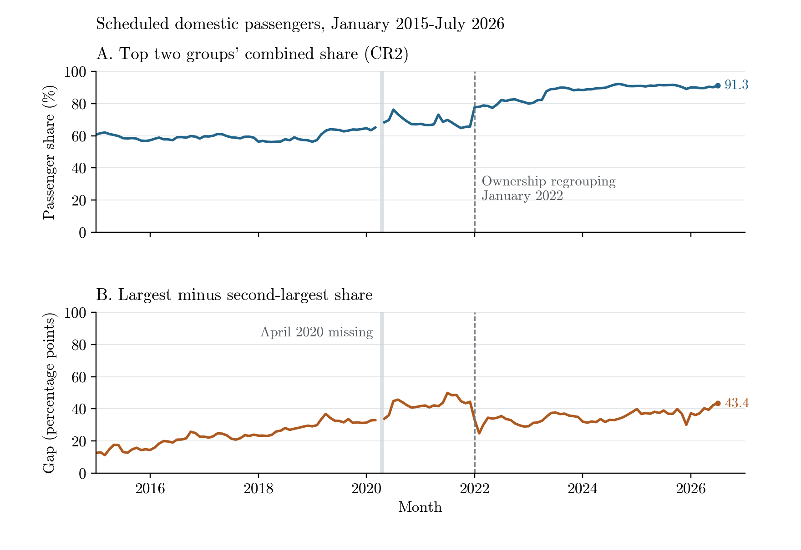
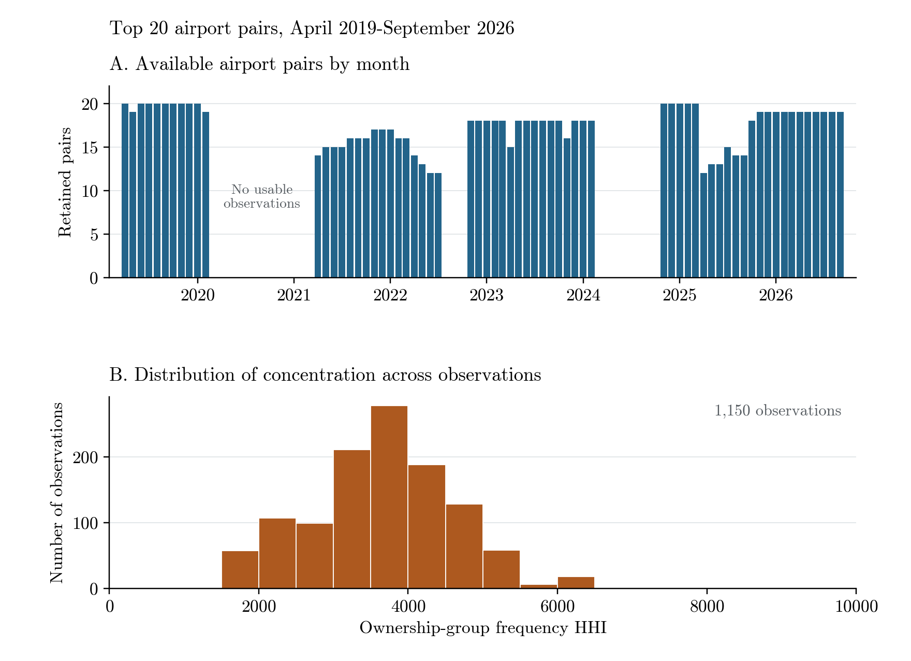
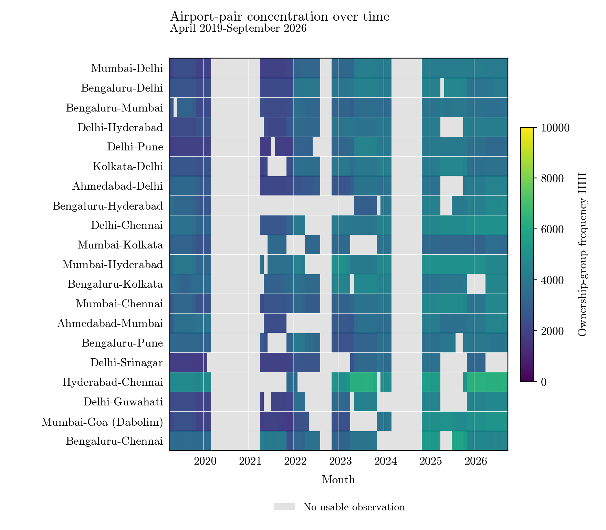

# Assignment 3 - O4 analysis code

Code and data for Goutham P's O4 contribution to the DA241o Managerial Economics project on Indian domestic aviation.

The report is maintained separately in [Economics_Assignment3_Template](https://github.com/Goutham7358/Economics_Assignment3_Template), which is linked to Overleaf.

## Current status

O4's individual EDA content is ready for review: three figures, the December capacity-input table, and a four-measure national descriptive summary. Preparation code, prepared CSVs and numerical outputs are included. The route workflow can rebuild its CSVs from the saved original DGCA PDFs. See [O4's instructions and checklist](O4/README.md) for run commands. Main-analysis results and hypothesis assessments remain to be written.

The first figure has two panels:

1. **CR2:** the combined passenger share of the two largest airline ownership groups each month.
2. **Share gap:** the largest group's passenger share minus the second-largest group's share, in percentage points.

The figure and a short description belong in Section 4, Descriptive and Exploratory Analysis, of the report.



The second figure shows available airport pairs by month and the distribution of ownership-group frequency HHI. It covers 1,150 retained route-months after the two documented TruJet-related exclusions. These are scheduled-frequency measures; the national figure uses passenger shares.



The third figure uses those same HHI values to show each airport pair over time. Grey cells indicate unavailable observations. It complements the pooled histogram, which is retained.



## Files

Generate all EDA figures and tables from the included prepared CSVs:

```sh
python3 O4/EDA/generate_figures.py
```

Install the packages in `requirements.txt` first if needed. PDF extraction and cleaning are separate steps in `data/source/`; plotting scripts are grouped in `O4/EDA/`.

| File or folder | Contents |
|---|---|
| `data/raw/carrier_monthly.csv` | Unchanged DGCA-derived airline traffic snapshot |
| `data/source/` | Data preparation code and workflow notes |
| `data/raw/route_schedules/` | Original DGCA schedule PDFs, with a separate fingerprint/URL manifest |
| `data/interim/routes/` | Extracted schedule rows and extraction audit |
| `data/processed/` | Prepared CSV and preparation audit |
| `data/SOURCE.md` | Source, version, fingerprint, variables and study filtering |
| `data/ROUTE_SOURCES.md` | Route sources, preparation, sample changes and data dictionary |
| `data/LICENSE.txt` | Upstream licence accompanying the dataset |
| `O4/EDA/eda_national.py` | Monthly group calculations, summary statistics and chart |
| `O4/EDA/eda_routes.py` | Route coverage, HHI distribution and pair-by-month heatmap |
| `O4/EDA/eda_capacity.py` | December 2024/2025 capacity-input table and its airline-level inputs |
| `O4/EDA/generate_figures.py` | One command to generate all EDA figures and tables from prepared CSVs |
| `O4/output/` | Figure, numerical tables and software versions |
| `requirements.txt` | Python plotting dependency |

Run instructions and output definitions are in [O4/README.md](O4/README.md). Source data are preserved; analysis scripts consume the prepared CSV, not the upstream download or PDFs.

## How we will write the code

- Use descriptive names and ordinary steps that can be read from top to bottom.
- Give each script one clear purpose. Add functions only when they make the calculation easier to follow.
- Explain economic definitions and important choices, such as ownership grouping, beside the relevant code.
- Keep dependencies small. Avoid unnecessary frameworks, configuration files and command-line options.
- Include the inputs needed to run the script without the surrounding economics-project folder. Use paths relative to the script's location.
- Save the numerical table behind each figure, so the plotted values can be checked.
- Document missing observations, exclusions, units, grouping dates and formulas. Preserve the source data.
- Record the software versions and run instructions used to generate submitted results.
- Check calculations against the underlying data before using them in the report.

## AI assistance

OpenAI Codex assisted with repository setup, documentation, national and route preparation/EDA code, adaptation of the existing PDF parser, calculation checks, and descriptive report text. The analysis follows the method submitted in Assignment 2, with the two TruJet-related route-month exclusions documented in the route source notes. The team must review the calculations and interpretations before submission and include the methods-and-tools disclosure required by the course.
